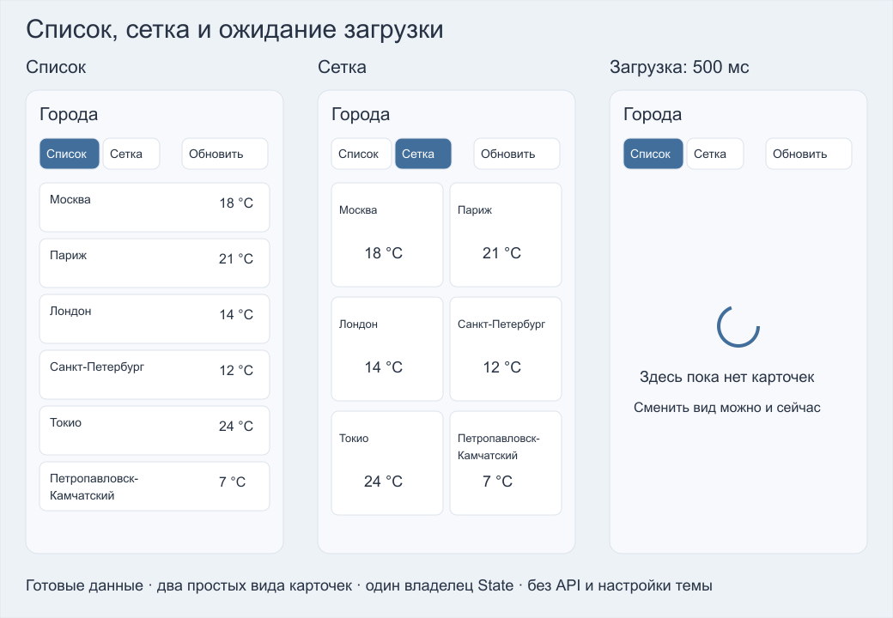

# Практика Flutter: список, сетка и загрузка

За 80 минут реализуйте **один StatefulWidget и два StatelessWidget в одном `lib/main.dart`**. Проект запускается до выполнения задания. Готовы модель города, запуск приложения и `loadCities()`, возвращающий шесть городов через 500 мс. Сеть, API, JSON и пакеты подключать не нужно.

## Запуск

Нужны [Flutter SDK](https://docs.flutter.dev/install) и Chrome. Проверено на Flutter 3.35.7 / Dart 3.9.2.

```sh
git clone https://github.com/GeorgFed/flutter-city-layout-task.git
cd flutter-city-layout-task
flutter pub get
flutter run -d chrome
```

При скачивании ZIP распакуйте его и откройте папку с `pubspec.yaml`; начинайте с `flutter pub get`. Пока TODO не выполнены, экран «Начните с TODO 1» — ожидаемый результат.

В терминале работающего приложения: `r` — hot reload, `R` — hot restart, `q` — выход. Установка SDK выполняется до начала практики.

## Макет



Макет — ориентир. Достаточно стандартных Card, Text и кнопок с небольшими отступами. Иконки, изображения, подбор шрифтов и настройка темы не нужны. Выбора отдельного города и верхней карточки выбранного города нет.

## Что реализовать

| Виджет | Задача |
|---|---|
| `CitiesPage` — StatefulWidget | Хранить режим и Future; показывать кнопки «Список», «Сетка», «Обновить». Отметить текущий режим. Через FutureBuilder показывать ожидание и данные в нужном виде. |
| `CityListCard` — StatelessWidget | Простая Card: название слева, температура справа. Длинное название переносится. |
| `CityGridCard` — StatelessWidget | Простая Card: название сверху, температура снизу. Две колонки; название можно ограничить двумя строками и многоточием. |

Каркасы классов оставлены, чтобы незаполненный проект компилировался. Заполните TODO 1–4; все изменения — в `lib/main.dart`. Температуру показывайте как `${city.degrees} °C`.

### Два основных решения

1. **Жизнь Future.** При первом открытии начинается загрузка. «Обновить» создаёт новый Future и показывает CircularProgressIndicator на время ожидания. Смена списка/сетки меняет только режим и не запускает запрос заново, даже во время ожидания. Не вызывайте `loadCities()` внутри build; callback setState должен быть синхронным и не возвращать Future.
2. **Ограничения layout.** Кнопки остаются сверху, список/сетка получают оставшуюся конечную высоту. Длинный город не выталкивает температуру за экран. Все шесть городов доступны при прокрутке.

Для двух кнопок режима можно использовать обычные кнопки или `ToggleButtons` с `isSelected` и `onPressed`. Для шести готовых городов подходят обычный ListView и GridView.count; ленивые builder-конструкторы тоже допустимы. Достаточно двух колонок, без адаптивного изменения их числа.

`loadCities()` всегда успешно возвращает данные через 500 мс. Обработка ошибок, сохранение данных между запусками, Theme и другие дополнительные функции **не входят в обязательную часть**.

## Приёмка

- Первый запуск и «Обновить»: сначала виден индикатор, через 0.5 с — города.
- Список → сетка → список: данные не пропадают на новую загрузку; активный режим заметен.
- Во время ожидания можно сменить режим; после завершения появляются данные в последнем выбранном виде.
- При ширине 320 и 800 logical px всё читается; в окне высотой 480 px можно прокрутить до последнего города без overflow.
- Названия кнопок: «Список», «Сетка», «Обновить»; индикатор — CircularProgressIndicator. Это позволяет запустить готовую самопроверку.

Проверить настройку и запуск незаполненного шаблона:

```sh
flutter analyze
flutter test
```

Проверить готовое решение:

```sh
flutter test test/behavior_check.dart
```

Последняя команда ожидаемо не проходит до реализации TODO. Она проверяет время ожидания, отсутствие перезапуска при смене вида, обновление и узкий экран. Визуально дополнительно проверьте отступы и читаемость.

Ориентир: 5 минут запуск, 15 карточки, 20 список/сетка, 20 состояние и FutureBuilder, 15 проверки, 5 объяснение. Это план, а не измеренное время новичка. Разрешены [примеры лекции](https://github.com/GeorgFed/flutter-widgets-examples), документация и агенты; студент объясняет свой код.

Результат: `main.dart`/commit, скриншоты списка и сетки, короткая запись ожидания после «Обновить», результат самопроверки. Срок и канал сдачи преподаватель сообщает отдельно.
